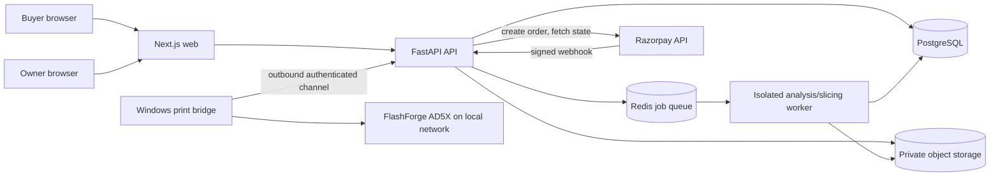

# `xxx` Architecture

## Architecture goals

Keep public web traffic, untrusted model processing, the Razorpay provider boundary, and the physical printer in separate trust zones. Produce deterministic estimates and immutable quotation snapshots. Make every business-critical transition auditable and retry-safe. Preserve manual payment and printer-operation fallbacks without weakening the primary gates.

## Canonical data and flow contracts

The October 21 role dashboards extend the commerce workflow on GitHub main `d826901`, not a
replacement for its redesigned storefront or local station. `GET /api/v1/buyer/dashboard`
requires a database-validated buyer principal and scopes request/order/unexpired-issued-quotation
counts to that buyer. `GET /api/v1/owner/dashboard` requires the primary owner and adds global
job, payment-intent, fulfilment and notification status counts plus non-secret setup booleans.
Both are read-only, rate-limited, no-store aggregates. They return no record IDs, buyer identity,
addresses, filenames, money totals or machine status. No tables or migrations are added.

The browser checks the existing cookie/session API before fetching records. Password and MFA
login results choose `/orders` or `/operations` from the returned role; a mismatch offers the
correct dashboard without fetching lists. These UI checks do not replace API authorization.
The shared `SiteHeader` accepts an optional presentation-only dashboard role; without it, the
public homepage and print workspace render their existing navigation unchanged. The skip link
targets the dashboard's focusable main region. The design uses existing appearance variables.

The commerce quotation policy remains separate from approved local print-station rates. No
public dashboard route connects to native printer controls, and no commissioning/settings
changes are introduced. The permission boundaries follow [OWASP authorization guidance](https://cheatsheetseries.owasp.org/cheatsheets/Authorization_Cheat_Sheet.html):
deny by default and validate permissions for each request.

The implementation currently delivers the local/manual slice described in
[`LOCAL_WORKFLOW.md`](LOCAL_WORKFLOW.md). Razorpay and workflow SMTP have implemented,
disabled-by-default adapters tested with fictional payment state and a local mail sink. Direct
AD5X control is a target integration, not a printer command. Contract revision 1.5 records the
implemented subset and deferred fields; existing submission diagrams describe the broader target.

The October 19 delivery adds owner-maintained, hash-pinned print offerings and captured
specifications through request, slicing, quotation and accepted order. The approved local
storage adapter receives authenticated same-origin bytes and shares private objects with the
worker; it is explicitly not a production/S3 replacement. See `DATA_MODEL.md` section 16 and
`VISIT_PREFLIGHT.md` for the exact software/hardware acceptance boundary.

- [`DATA_MODEL.md`](DATA_MODEL.md) is the authoritative MVP schema contract for tables, keys, relationships, states, invariants and migration order.
- [`DATA_FLOW.md`](DATA_FLOW.md) is the authoritative Level 0–2 information-flow contract for external entities, numbered processes, data stores, balancing and prohibited flows.
- ER/DFD images in `submission/diagrams/` are generated views of those contracts. If an image and the written contract disagree, implementation stops until both are reconciled in one reviewed change.

## System view



## Repository shape

```text
apps/
  web/                 Next.js buyer and owner interfaces
services/
  api/                 FastAPI application and database migrations
  worker/              isolated model analysis, preview, and slicing jobs
  print-bridge/        Windows bridge and printer adapters
packages/
  contracts/           generated/shared API schemas where practical
infra/                 local containers and deployment configuration
docs/                  product, architecture, security, and operations
```

Do not share ORM models directly with the frontend. The API owns public schemas and publishes an OpenAPI contract. Generate frontend types from the reviewed contract after endpoints stabilize.

## Component responsibilities

### Next.js web

- Public service and policy pages.
- Buyer authentication, uploads, quote/order/payment status, and fulfillment tracking.
- Owner-only operational console.
- No pricing authority, paid transition, queue transition, or printer command originates from client state.

### FastAPI API

- Authentication, JWT lifecycle, authorization, CSRF controls, and owner MFA.
- Buyer, model, quotation, Razorpay order/webhook/reconciliation, fallback payment, order, queue, fulfillment, bridge, and audit APIs.
- State-machine enforcement, idempotency, rate limiting, signed upload/download coordination, and notification intents.
- No CPU-heavy model parsing or slicing in request handlers.

### PostgreSQL

Primary system of record. The complete official table set, exact columns, keys,
cardinalities, state values, constraints and migration order are defined only in
[`DATA_MODEL.md`](DATA_MODEL.md). This architecture document intentionally does
not maintain a second abbreviated entity list.

Use UUID/ULID public identifiers, UTC timestamps, integer paise for money, integer or fixed-precision units for grams/minutes, optimistic version columns for contested owner actions, and database constraints for uniqueness/invariants.

### Redis-backed worker queue

- Virus/malware scan orchestration.
- Model metadata extraction and bounded rendering.
- Slicer execution with strict resource/time limits.
- Estimate calculation from a versioned pricing policy.
- Email delivery and retryable operational notifications.
- Transactional outbox consumption.

Jobs are idempotent and keyed by immutable input hashes plus analysis/profile versions.

### Private object storage

Store original models, sanitized derivatives, previews, sliced artifacts, and optional payment evidence under separate prefixes/buckets. Default private, encrypted, versioned where supported, and accessed through short-lived signed URLs. Database records contain hashes, size, media type, ownership, scan status, and retention state.

### Analysis/slicing sandbox

- Runs separately from API processes as a low-privilege user with no secrets or printer/network access.
- Receives immutable object references and approved profile IDs.
- Enforces CPU, RAM, wall-clock, file-count, decompression, output, and filesystem limits.
- Produces structured results, logs, hashes, previews, and a sliced artifact; never mutates the original.
- Treats slicer output as untrusted until schema/range validation succeeds.

Begin with upstream OrcaSlicer CLI behavior and an AD5X-compatible profile. Validate equivalence with Orca-Flashforge on the actual Windows hardware before trusting production estimates or sends.

### Windows print bridge

The bridge is a separate installable process at the business premises. It makes outbound HTTPS/WebSocket requests so no inbound router port is required.

Responsibilities:

- Pair once using a short-lived owner-generated code, then store a rotated installation credential in Windows-protected storage.
- Heartbeat with bridge version, printer adapter, firmware, connectivity, current state, and active job ID.
- Claim one authorized job with a lease and job-specific idempotency key.
- Download the approved sliced artifact over a short-lived URL and verify its SHA-256 hash.
- Recheck printer idle/ready state and report a structured refusal when preconditions fail.
- Send/start through a tested AD5X adapter; stream normalized progress and terminal events.
- Persist enough local state to reconcile after process, network, or computer restarts.
- Expose a tray/console status and emergency disconnect for the owner.

The first adapter milestone is an investigation, not an assumed public API. Prefer LAN-only control where reliable. If direct automation cannot be proven, the bridge downloads the approved artifact and guides the owner through the official Orca-Flashforge send flow while preserving web status and auditability.

## Authentication and session design

- Email/password buyer accounts with verified email before uploads or orders.
- Owner account created by an explicit deployment/administrative procedure, never public signup.
- Argon2id password hashing with per-user salts and configurable work factors.
- Short-lived JWT access token; rotating opaque or JWT refresh token represented by a hashed server-side session record.
- Secure, HTTP-only, SameSite cookies; never browser local storage.
- CSRF tokens for state-changing cookie-authenticated requests.
- Owner MFA and recent-authentication checks for payment exceptions/refunds, manual-fallback verification, queue overrides, printer actions, and security changes.
- Session/device list, targeted revocation, credential-change revocation, and bounded concurrent sessions.

## Quotation consistency

An analysis run references immutable hashes for the source model, sanitized derivative, slicer binary/profile, and configuration. A quote references the analysis and a pricing-policy snapshot. Quote acceptance creates an order snapshot. Re-analysis or repricing creates a new version rather than rewriting accepted evidence.

All money uses paise. Never use floating-point arithmetic for money. Unit conversions occur at explicit boundaries and are covered by golden pricing tests.

## Payment transition

The primary MVP payment adapter is `razorpay`:

1. After quote acceptance, FastAPI creates a local payment intent and a Razorpay Order for the exact immutable INR amount.
2. The web opens Razorpay Checkout with the public Key ID and the stored provider Order ID. No secret or caller-selected amount is sent from the browser.
3. The checkout callback is submitted to FastAPI for server-side HMAC verification and immediate buyer feedback, but it creates no queue effect.
4. Razorpay sends asynchronous webhooks. FastAPI verifies `X-Razorpay-Signature` over the raw body before trusting the payload and deduplicates `x-razorpay-event-id`.
5. The payment handler correlates local order, provider order, provider payment, INR amount and current provider state. It accepts out-of-order delivery and fetches provider state when reconciliation is necessary.
6. Only exact current captured/unrefunded payment plus paid-order evidence can call the internal `record_captured_payment` transition. Signed webhook and server-authenticated API observations retain different validation evidence. `authorized`, failed, mismatched, unsigned, replayed or client-only results fail closed.
7. One database transaction records the captured payment, moves the order to `PAID_CONFIRMED`, appends audit evidence and writes one print-job outbox event.
8. Outbox processing enqueues the print job exactly once.

The fallback adapter is `manual_upi`. It is disabled by default and requires an owner-issued intent, buyer claim, owner verification against the actual beneficiary account, recent MFA and the same provider-neutral `confirm_payment` transition. See [`adr/0007-razorpay-primary-payments.md`](adr/0007-razorpay-primary-payments.md).

## Print authorization protocol

Starting a job requires all of:

- Order is `PAID_CONFIRMED` and print job is the authorized next job.
- Quote, model, analysis, profile, and sliced-artifact hashes still match.
- Owner completed a readiness checklist with recent authentication.
- Bridge heartbeat is fresh; bridge/printer report idle and compatible.
- A server-issued authorization has a short expiry, unique nonce, and job/bridge/printer binding.
- Bridge atomically claims the authorization before sending.

Duplicate requests return the existing command result. Conflicting job or printer states fail closed and require owner review.

## Deployment topology

For production, deploy the public web/API/worker/database/storage in a region appropriate for Indian customers, with TLS, managed backups, and separate development/staging/production secrets. The Windows bridge remains on the business LAN. Development uses Docker Compose with emulated email and S3-compatible storage.

Do not expose PostgreSQL, Redis, object storage administration, worker dashboards, or the bridge directly to the public internet.

## Observability and recovery

- Structured logs with correlation, request, job, order, provider-order and bridge IDs; never log tokens, passwords, payment secrets/signatures, model contents, full webhook bodies, or signed URLs.
- Metrics for API errors/latency, queue delay/failure, slicing duration, quote drift, Razorpay order-creation failures, webhook validation/processing delay, payment reconciliation age, bridge heartbeat age, print failures, and storage growth.
- Owner-visible alerts for stalled analysis, invalid/mismatched payment events, unreconciled payments, offline bridge, stuck printing, and failed notifications.
- Database point-in-time recovery where available, object-storage lifecycle/backup, and tested restore procedures.
- Reconciliation commands for Razorpay payments/refunds, fallback payments, outbox, jobs and bridge state; commands must be idempotent and audited.

## Contract gates before dependent implementation

- The versioned pricing engine may be implemented without seeded values, but production policy
  activation and golden-case acceptance wait for the outstanding material/rate decisions in
  `PRODUCT_REQUIREMENTS.md`.
- Real Razorpay test verification waits for approved test credentials/webhook configuration; adapter code is implemented and disabled by default. Live Checkout waits for merchant onboarding/KYC, live credentials, HTTPS, enabled methods, capture settings, settlement/reconciliation ownership and approved refund/cancellation policies.
- Manual UPI fallback waits for the beneficiary VPA/QR and owner verification procedure.
- Direct printer send/start waits for a hardware spike against the actual AD5X, firmware, Orca-Flashforge setup, and network mode.
- Tax invoices wait for legal entity and GST decisions.
- Public policies wait for owner-approved terms, privacy, retention, refund, prohibited-content, and fulfillment wording.

## Current local print station (October 19 scope override)

The owner deferred the business platform. `/print` on the configured loopback web port
(default 3102, Windows test installation 3100) talks only to the local station on loopback
8123 through an explicit station-mode rewrite, including optimized builds. The station validates a
bounded STL/OBJ upload, preserves original bytes, applies explicit units/X-then-Y rotation,
validates the resulting geometry, then runs hash-pinned Orca with standalone reviewed profiles.
Only layer height, infill, supports, selected plate and filament-colour metadata are varied;
machine motion/heating macros stay in the reviewed base profiles. Multi-copy requests clone
raw meshes before arranging; more than one output plate is rejected.

One private SQLite journal and per-job directories replace server databases/queues on this
path. There is one active job, a unique submission token/fingerprint and a durably recorded
physical-start intent. A crash before intent fails the local job; a crash or ambiguous result
after intent blocks further jobs for inspection, never retrying the physical send. This does
not guarantee printer/network availability or rule out actions from other printer clients.

For the confirmed ZMOD installation, Moonraker receives the generated single-tool G-code
with its checksum and `print=false`. After confirming a non-printing upload and rechecking
idle state and live IFS material/colour, the paired native AD5X `/printGcode` request starts
that exact filename with an explicit T0-to-slot mapping. Physical starts require native
pairing; automatic matching and the currently loaded spool are never a fallback. The
existing native start's flow-calibration flag and configured leveling choice are retained.
ZMOD compatibility metadata and MD5 remain in the artifact; SHA-256 identifies the exact
bytes. The declared material/colour must match the requested slot before any upload.
Preparation context versions this dispatch protocol; earlier estimates need a fresh slice.
Standard Moonraker does not expose IFS colour identity. Paired native `/detail` status
provides the live slot checks, alongside a fresh physical operator readiness confirmation.
The explicit stock adapter instead sends a sliced 3MF using FlashForge's LAN contract and
checks its live IFS slot/material/colour. No transport is silently substituted for another.

Only an exact filename match associates live printing/completion with the job; heating
remains awaiting start. Native active filenames take precedence over stale Moonraker
selections. Explicit cancellation with inactive execution and heaters off ends an attempt.
When Moonraker retains a standby selection after a native stop, the monitor requires
native ready with no filename, inactive SD execution, zero heater targets and an empty queue.
After a 90-second start grace period, at least three consistent observations over 12 seconds
of monotonic time mark the attempt `stopped`. Loss of either configured connection or any
activity resets this observation window. Matching Moonraker history can identify completion
or cancellation explicitly; otherwise `stopped` does not claim which occurred. No terminal
transition resends a file or starts another job. No arbitrary G-code console, movement,
temperatures, firmware changes, cloud service, payments or public printer-control endpoint
are exposed. The existing
business architecture in the other sections is preserved separately, not required for local printing.

The owner's October 20 LAN request adds an opt-in `run --lan-host <private IPv4>` web
binding and exact Host/Origin allowlist entry. The API still binds only loopback and
disregards forwarded client headers. LAN devices use relative `/api/printer` requests
through Next, with the same submission token and physical-start gates. The frontend
uses a SHA-256 fallback and cryptographically random UUIDs when the LAN's HTTP origin
does not provide secure-context Web Crypto methods. This shares the operator station
with trusted LAN devices; it does not implement internet hosting or customer accounts.

The local station also supports an optional private material/time rate card. After actual
slicing, pricing-v1 uses integer milligrams, seconds and paise to store an INR estimate
snapshot with its exact rates and measured plate totals. The upload API cannot supply price
inputs. Rates are configured under the existing station lock with the `rates` CLI command;
an explicit flag can add estimates to previously unpriced slices without replacing existing
snapshots. These two-component estimates do not implement a tax, fulfillment or payment policy.
The confirmed local rates are documented in `PRODUCT_REQUIREMENTS.md`.

The buyer website obtains a slice-only job before offering to print. The review panel
shows its persisted estimate, tied to the current file selection and all model/print
options. `POST /api/printer/jobs/{job_id}/start` accepts the expected total, a fresh
idempotency token and operator readiness. A SQLite transaction claims that sliced job
under the existing one-active-job index. The dispatcher rechecks profile approval,
preparation context, file hashes and live printer readiness, then sends the original
prepared artifact under the usual durable start intent. No second upload, slice or
price calculation occurs. Retries return the existing authorization without dispatch;
changed authorizations and any previously started estimate cannot start again.

## Order-to-station adapter — October 21, 2026

The commerce application and the native station remain separate. Browser buyers use authenticated
ordering APIs; only the owner uses production authorization. The station makes outbound,
credential-scoped requests and is not exposed through the ordinary website's printer proxy.
Existing native station/driver/slicer code is unchanged from the recorded working baseline.

No migration is needed: `BridgeInstallation.adapter_name` selects `manual-orca` or
`station-zmod-v1`; `PrintAuthorization` binds the owner, readiness check, printer and manifest;
append-only `PrintJobEvent` rows carry `plate_*` observations. Authorization and the job's
`ready_to_print -> authorized` transition commit together. A compare-and-swap claim consumes the
grant once and moves the job to `claimed`; repeated claims return the same approved payload.

Owner `GET/POST /api/v1/owner/production/{job_id}/dispatch` reports eligibility/connectivity and
issues a two-minute authorization. The station's `/api/v1/bridge/dispatches` endpoints list,
claim, download and report observations. Downloads are hash-verified and rechecked after I/O.
The server acknowledges the durable `sent` intent before any upload; that label means
"preparing to print" to the buyer, not successful printer execution.

`services/bridge/commerce_connector.py` imports a single approved G-code plate into the existing
local journal. `tools/run_commerce_station.py` holds the same `station.lock` as the native runner
and exposes the unchanged local app/monitor. A separately private connector configuration stores
the API credential and approved commerce profile hashes/plate types. It never edits native
configuration. Native `/start` cannot validate a commerce row's display-only options.

The physical boundary is: local durable intent -> API acknowledgement -> exactly one existing
`upload_and_print` call. Transport failure or restart after intent requires inspection, never
resending. Exact filenames and wire hashes bind subsequent observations. Confirmed completion
sets job/order to `qa` and releases the reservation; the owner still passes QA and records
fulfilment. Progress observations are deduplicated in ten-percent buckets and exact outbound
event bodies survive API outages. Cancellation/uncertainty are observations, not assumed success.

The owner status payload includes the latest grant's `claimedAt`, `revokedAt` and `expiresAt`.
An expired or revoked **unclaimed** grant can be cancelled even while sending is disabled.
A conditional grant update and job/order version checks ensure cancellation and claim cannot
both win. The reset retains the reservation, returns to preparation, records audit/notice
evidence and requires fresh readiness. The owner panel handles only the explicit
`authorization_reset_readiness_required` response as successful recovery. Claimed attempts
cannot take this path.
